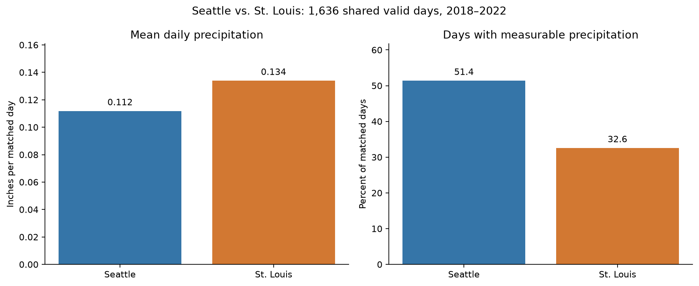

# Does It Rain More in Seattle Than in St. Louis?

## The problem

My parents think it rains too much in Seattle, Washington. To explore that belief,
I compared Seattle with St. Louis, Missouri. "Rains more" can mean either more
days with precipitation or a greater amount of water. These are different
questions: frequent light rain may add up to less water than occasional heavy
storms.

## The data

The analysis uses daily weather records from January 2018 through December 2022
in the project's [Seattle](data/seattle_rain.csv) and
[St. Louis](data/stl_rain.csv) files. I compared a Seattle neighborhood station
with St. Louis Lambert International Airport.
Using one station per city avoids counting several stations as separate days.
The project owner confirmed that precipitation is measured in inches. These
measurements can include melted snow, so "precipitation" is more accurate than
"rain" alone.

The files follow [NOAA Climate Data Online](https://www.ncei.noaa.gov/cdo-web/)
field conventions, but the original download links and export settings were not
provided. Their exact source could therefore not be independently verified.

## How I compared the cities

I checked the files for duplicate records, missing measurements, and dates outside
the study period. I converted dates and precipitation amounts into consistent
formats, selected the two stations, and excluded St. Louis records from 2017.
Missing measurements were not treated as zero because an unknown amount does
not mean a dry day.

To make a fairer comparison, I used only dates with a precipitation measurement
in both cities. This left **1,636 shared days**, or **89.6%** of the study period.
I calculated the average precipitation per day, including dry days, and the
percentage of days with at least **0.01 inches** of precipitation. I also examined
monthly patterns. The [analysis notebook](code/Weather_Data.ipynb) reproduces the
results from the original files.

## What the results show

*Figure 1. Both comparisons use the same 1,636 dates in 2018–2022. A wet day has
at least 0.01 inches of precipitation. Both bar-chart scales start at zero.*

Seattle had measurable precipitation on **51.4%** of observed days, compared with
**32.6%** in St. Louis: about 19 additional wet days per 100 observed days.
However, St. Louis received more water per day on average: **0.134 inches**,
compared with **0.112 inches** in Seattle.

Heavier wet days help explain the difference. On wet days alone, St. Louis
averaged **0.411 inches**, nearly twice Seattle's **0.218 inches**.

## Conclusion and limitations

**Seattle was wetter by frequency, but St. Louis was wetter by amount.** The
concern about frequent wet weather in Seattle is supported by these observations,
but not the idea that Seattle necessarily receives more water.

These findings describe the selected stations and available dates, not every
neighborhood or long-term climate. Missing dates could affect the comparison,
and five years may not represent typical conditions. The observed amounts are
not complete annual totals. Whether Seattle is "too rainy" remains a personal
preference, but distinguishing frequency from amount makes that judgment better
informed.
